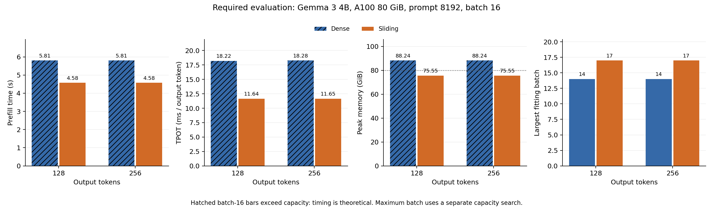
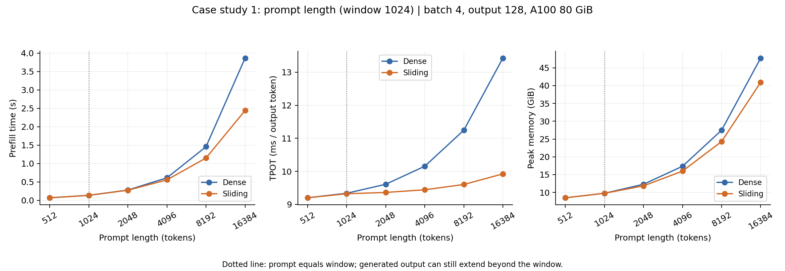
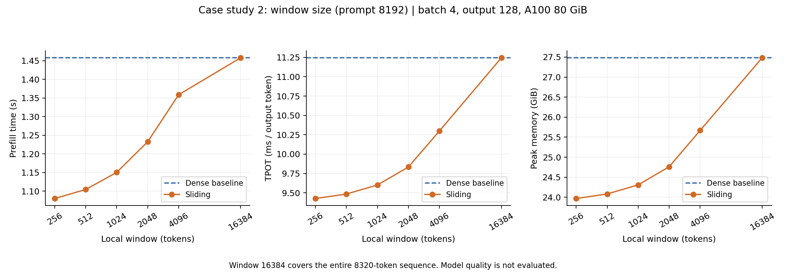

# Project 2 results: sliding-window attention

Generated by `python reproduce.py`. These are analytical estimates, not GPU measurements.
All runs use Gemma 3 4B and the unchanged single-A100 80 GiB hardware config.
Sliding uses 29 local layers and 5 global layers (every sixth layer global).

## Required evaluation (Table 1 / Figure 1)

| Attention | B | Prompt | Output | Window | Prefill (s) | TPOT (ms) | Peak (GiB) | Fits | Max B |
|---|---:|---:|---:|---:|---:|---:|---:|:---:|---:|
| dense | 16 | 8192 | 128 | global | 5.8061 | 18.2157 | 88.2425 | NO | 14 |
| sliding | 16 | 8192 | 128 | 1024 | 4.5776 | 11.6443 | 75.5550 | yes | 17 |
| dense | 16 | 8192 | 256 | global | 5.8061 | 18.2839 | 88.2425 | NO | 14 |
| sliding | 16 | 8192 | 256 | 1024 | 4.5776 | 11.6543 | 75.5550 | yes | 17 |

At output 128, prefill is 1.268x faster and TPOT is
1.564x faster in the analytical model. Peak memory changes from
88.2425 to 75.5550 GiB; maximum fitting batch changes from
14 to 17. Dense at batch 16 exceeds capacity: its timing is
a theoretical comparison, not deployable throughput or a measured speedup.

## Case study 1: prompt length (Table 2 / Figure 2)

Question: when does a fixed 1024-token window start helping? Batch is 4; output is 128.

| Attention | B | Prompt | Output | Window | Prefill (s) | TPOT (ms) | Peak (GiB) | Fits | Max B |
|---|---:|---:|---:|---:|---:|---:|---:|:---:|---:|
| dense | 4 | 512 | 128 | global | 0.0691 | 9.1988 | 8.4927 | yes | - |
| sliding | 4 | 512 | 128 | 1024 | 0.0691 | 9.1988 | 8.4927 | yes | - |
| dense | 4 | 1024 | 128 | global | 0.1358 | 9.3351 | 9.7586 | yes | - |
| sliding | 4 | 1024 | 128 | 1024 | 0.1358 | 9.3206 | 9.7586 | yes | - |
| dense | 4 | 2048 | 128 | global | 0.2800 | 9.6079 | 12.2903 | yes | - |
| sliding | 4 | 2048 | 128 | 1024 | 0.2744 | 9.3607 | 11.8372 | yes | - |
| dense | 4 | 4096 | 128 | global | 0.6126 | 10.1533 | 17.3538 | yes | - |
| sliding | 4 | 4096 | 128 | 1024 | 0.5576 | 9.4409 | 15.9944 | yes | - |
| dense | 4 | 8192 | 128 | global | 1.4577 | 11.2442 | 27.4808 | yes | - |
| sliding | 4 | 8192 | 128 | 1024 | 1.1505 | 9.6013 | 24.3089 | yes | - |
| dense | 4 | 16384 | 128 | global | 3.8659 | 13.4260 | 47.7347 | yes | - |
| sliding | 4 | 16384 | 128 | 1024 | 2.4418 | 9.9222 | 40.9378 | yes | - |

At prompt 512, the entire 640-token sequence fits inside the window and dense/sliding results
match. At prompt 1024, prefill still fits, but decode extends beyond the window. At prompt
16384, dense/sliding TPOT is 13.4260/9.9222 ms
(1.353x ratio), and peak memory is
47.7347/40.9378 GiB.

Local decode attention and retained KV stop growing after window saturation. Global layers
still grow with context, and prefill must process every prompt token through projections,
FFNs and the vocabulary head. Thus total cost and peak memory do not become constant.
Tile boundaries and GEMM kernel selection can make the curves stepwise rather than smooth.

## Case study 2: window size (Table 3 / Figure 3)

Question: how does the attention budget change cost? Batch is 4, prompt 8192, output 128.

| Attention | B | Prompt | Output | Window | Prefill (s) | TPOT (ms) | Peak (GiB) | Fits | Max B |
|---|---:|---:|---:|---:|---:|---:|---:|:---:|---:|
| dense | 4 | 8192 | 128 | global | 1.4577 | 11.2442 | 27.4808 | yes | - |
| sliding | 4 | 8192 | 128 | 256 | 1.0805 | 9.4269 | 23.9691 | yes | - |
| sliding | 4 | 8192 | 128 | 512 | 1.1047 | 9.4850 | 24.0823 | yes | - |
| sliding | 4 | 8192 | 128 | 1024 | 1.1505 | 9.6013 | 24.3089 | yes | - |
| sliding | 4 | 8192 | 128 | 2048 | 1.2327 | 9.8340 | 24.7620 | yes | - |
| sliding | 4 | 8192 | 128 | 4096 | 1.3588 | 10.2992 | 25.6683 | yes | - |
| sliding | 4 | 8192 | 128 | 16384 | 1.4577 | 11.2442 | 27.4808 | yes | - |

For window 256 versus 16384, TPOT is 9.4269 versus 11.2442 ms,
and peak memory is 23.9691 versus 27.4808 GiB. The largest window
covers all 8320 tokens and matches dense timing/memory; this equivalence is checked by the script.
Smaller windows reduce only local attention work and local KV retention. Unchanged global
layers and non-attention operations limit savings. This experiment does not measure language
model quality, so it cannot establish which window has the best accuracy/performance tradeoff.

## Reading and reproducing the data

- `required.csv`, `prompt_sweep.csv`, `window_sweep.csv`: the rows behind Tables 1-3.
- `figures/*.png`: slide-ready images; matching `.svg` files are scalable versions.
- `study_data.json`: exact values used to regenerate figures and this report.
- `manifest.json`: input/code SHA-256 hashes, environment versions and wall-clock runtime.
- `runs/<case>/model.yaml`, `results.json`, `run.log`: exact inputs, metrics and simulator logs.
- `runs/<case>/output/LLM/memory-summary/`: graph-replayed prefill/decode memory summaries.
- `runs/capacity/`: memory-only probes, including the largest fitting batch and its failing neighbor.

TPOT = total decode seconds / output tokens * 1000, per sequence. Peak is the maximum of
prefill and final-decode peaks, per GPU, including weights, KV and modeled activations.
Capacity decisions use full precision, not rounded display values. The memory-only search
uses static memory plus the largest transient allocation, equivalent to this simulator's
sequential single-GPU inference replay; it does not reprice GEMMs at every batch.

Run details are regenerated and excluded from Git; this report, CSVs, figures and manifest
are the compact shareable snapshot. No model weights, CUDA, GPU or external dataset is needed.
